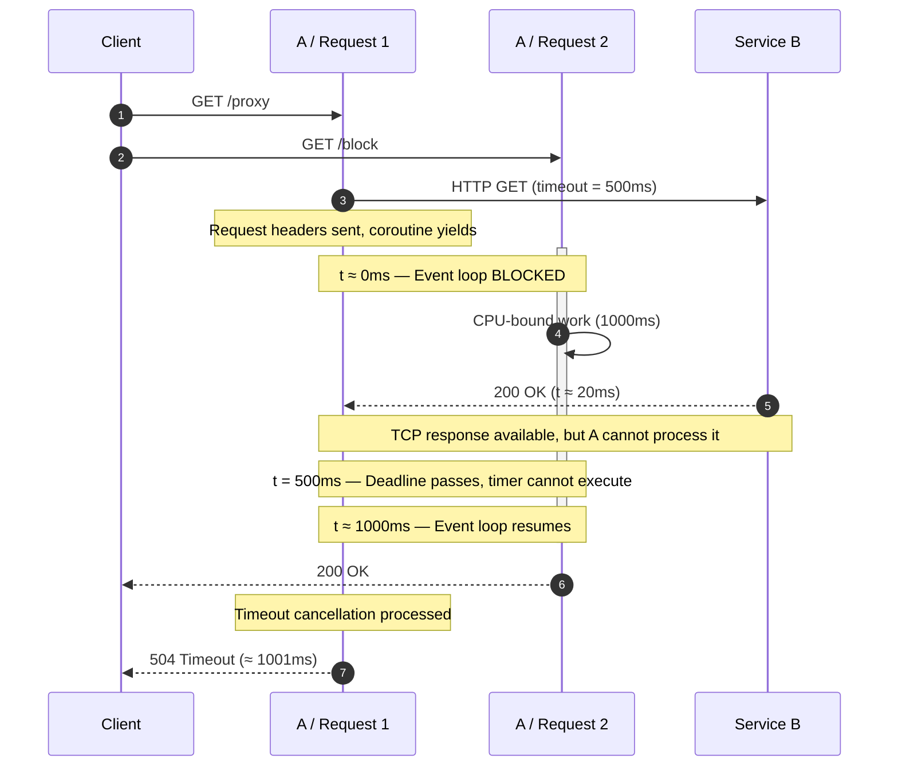

1. timeout does not necessarily imply that downstream service responded late

2. there is no definite way for a service to identify whether a specific request it's serving was timed-out by the client.
seriously. (blame the connection reuse)
